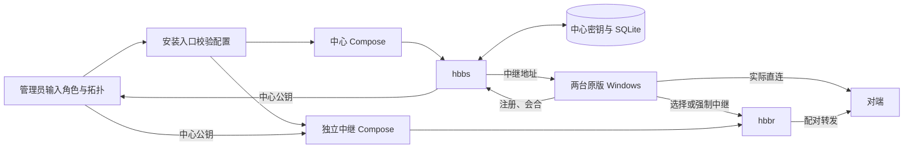

# Phase 1 · M0 安装与传输基线研究

**研究日期** 2026-11-22  
**范围** RustDesk Server OSS 1.1.16、独立中心和中继、原版 Windows 1.5.3 复跑取证  
**置信度** HIGH（固定镜像元数据、源代码及本地静态检查）／MEDIUM（官方文档中的部署参考）

<user_constraints>
## User Constraints (from CONTEXT.md)

### Locked Decisions

- **D-01:** 系统设计锁定 RustDesk Server OSS 1.1.16 与原版客户端 1.5.3，部署引用固定多架构镜像摘要。
- **D-02:** 中心的 RustDesk 身份、状态以及可复跑的拓扑配置持久化。启动、重跑和正常服务重建沿用同一中心公钥。
- **D-03:** 用户要求 M0–M3 首版开发完成后再做目标环境验收。验收先 Linux 中心和单中继，再用两台 Windows 终端验证注册、直连、强制中继和重建后仍以原公钥连接。开发阶段运行静态、构建和自动化检查。
- **D-04:** M0 安装原型使用既有 Docker Compose 运行环境。空机运行时安装、Web 首个管理员、终端强制管控与双区域自动选点按路线图实施。

### Deferred Ideas

目标环境的网络可达性、实际路径与 Windows 连接成功记录均在 Phase 5 采集。
</user_constraints>

## Summary

建议交付两份独立 Compose 配置及同一套安装入口。中心运行 `hbbs -k _ -r <中继主机>:21117`，挂载其持久目录到 `/root`。中继运行 `hbbr -k <中心公钥 Base64>`，独立部署且只接收中心公钥。上游按容器工作目录读写密钥与 SQLite，`hbbs` 启动时会解析并筛选中继地址。[VERIFIED: RustDesk Server 固定镜像源码] [会合参数][server-cli] · [密钥读取][server-key] · [数据库路径][server-db] · [地址解析][server-dns] · [中继密钥][relay-key]

开发验证覆盖两个角色的真实 Compose 解析、安装入口的状态与故障分支、取证步骤的可复跑性。在 Phase 5 记录目标主机可达性、两台 Windows 的实际传输路径及重建后使用原公钥连接。文档和测试产物应保留可验证的阶段边界。[VERIFIED: .planning/phases/01-m0/01-CONTEXT.md:12-25] [VERIFIED: .planning/ROADMAP.md:17-25,62-70]

## Architectural Responsibility Map

| 能力 | 执行位置 | 职责 |
| --- | --- | --- |
| 生成、启动、状态 | Linux 主机上的安装入口 | 固定镜像，解析拓扑，校验持久目录，调用独立 Compose 项目并输出有效配置。 |
| 注册、会合、下发中继 | 中心 `hbbs` | 使用持久密钥和 SQLite，提供原生 TCP/UDP 入口。[VERIFIED: 固定镜像源码] [会合启动][server-start] · [数据库路径][server-db] |
| 转发 | 独立 `hbbr` | 以中心公钥校验中继请求的 key 字段，按会话标识配对并转发。[VERIFIED: 固定镜像源码] [中继密钥][relay-key] · [中继配对][relay-pair] |
| 验证实际路径 | 两端原版 Windows 客户端及 Linux 中继 | 客户端报告安全状态、直连状态和流类型，中继日志报告配对。取证流程按时间窗关联两类证据。[VERIFIED: 固定版本源码] [客户端连接事件][client-event] · [中继配对][relay-pair] |

## Project Constraints (from AGENTS.md)

- 保持 Linux Docker Compose、Go 控制面、PostgreSQL、Vue 与 TypeScript 中文控制台及 RustDesk OSS 的技术边界。Windows 为首版受管平台，支持架构由验收确定。[VERIFIED: AGENTS.md:11-13]
- 后续受管授权需默认拒绝未获授权连接，两条传输路径均由受控端执行授权和租约。公共安装包只纳入经核对的公开连接配置，入网凭据按对象发放，发布核对签名、摘要和来源。[VERIFIED: AGENTS.md:14-15]
- 重试及重建保留中心身份与业务状态，任务可恢复并去重。开发阶段使用静态、构建和自动化检查。目标环境验收集中在首版开发完成后，`5 秒` 和 `35 秒` 保留为后续真机指标。[VERIFIED: AGENTS.md:16-17]
- 按现有仓库模式开发并通过 GSD 入口进行文件改动。项目技能声明为 `No project skills found.`。[VERIFIED: AGENTS.md:35-46,49-61]

<phase_requirements>
## Phase Requirements

| ID | 要求 | 研究支持 |
| --- | --- | --- |
| BASE-01 | 管理员可用固定版本和摘要生成 Linux 中心与单中继的 Compose 配置，配置包含正确发布的原生端口。 | 用规范化 Compose JSON 核对两个角色的端口、镜像与参数。[VERIFIED: .planning/REQUIREMENTS.md:10-12] |
| BASE-02 | 管理员可重复运行安装原型，查看有效中心和公钥指纹，并用持久状态重建服务。 | 用安全的首次初始化、持久目录、重建证据及故障回归支持。[VERIFIED: .planning/REQUIREMENTS.md:13-13] |
| BASE-03 | 测试人员可复跑双 Windows 注册、直连、强制中继和服务重建的取证步骤。 | 交付复跑命令、取证模板、通过条件及失败分支。执行按 D-03 进入 Phase 5。[VERIFIED: .planning/REQUIREMENTS.md:14-14,52-52] |
</phase_requirements>

## Standard Stack

| 组件 | 固定输入／环境 | 来源 |
| --- | --- | --- |
| RustDesk Server OSS | `docker.io/rustdesk/rustdesk-server:1.1.16@sha256:8ecdab65deb7c84652a626380e31d11a8f1fbafd97916d57f95c20628f943c00` | 发行于 2026-07-20。Buildx 从 Docker Hub 查得该 OCI 索引包含 `linux/amd64`、`linux/arm64` 及 `linux/arm/v7`。保留索引摘要以让引擎选择匹配架构。[VERIFIED: GitHub Releases、Docker Hub OCI 索引] [OSS 发行页][server-release] |
| 镜像对应源码 | OCI 标签 `org.opencontainers.image.revision=c3a3e0d1070e29cb28b468cf6ef5b184e65e4051` | GitHub `1.1.16` 标签指向 `73523b31cfd25d77dee862e6fc9f5e1fb5e485ef`。镜像版本比该标签多两个构建提交，比较范围仅变更 `.github/workflows/build.yaml`，本研究所引用的服务源文件和 classic Dockerfile 在两端逐字节相同。[VERIFIED: Docker Hub 镜像配置、GitHub Compare] [提交对比][server-compare] |
| 原版 Windows 客户端 | `1.5.3` | 发行于 2026-11-09，官方发布含 `rustdesk-1.5.3-x86_64.msi`、`rustdesk-1.5.3-aarch64.msi` 及相应 EXE。按客机架构选择并记录 SHA-256。[VERIFIED: GitHub Releases API] [客户端发行页][client-release] |
| 配置与生命周期 | Docker Compose，配置验证使用 `docker compose config --format json` | CLI 解析插值并把端口和卷展开成规范模型。[CITED: docs.docker.com/reference/cli/docker/compose/config/] |

使用现有运行环境、标准库和固定上游镜像。该方案无需新增语言包安装。镜像配置及注册表校验记录应包含仓库、索引摘要、平台与镜像选中的平台摘要。

## Architecture Patterns



### 独立配置与端口

- 中心仅发布 `21115/tcp`、`21116/tcp`、`21116/udp`，依次承担 NAT 测试、会合 TCP、注册与心跳。中继仅发布 `21117/tcp`。设计将 `21118`、`21119` 留给 WebSocket 扩展，`21114` 属 Pro 管理入口。使用 bridge 配合明确的 `ports`，分别渲染和验证，项目名及配置路径稳定。[VERIFIED: docs/DeskRealm-System-Design-v0.1.md:202-210，原文为「原生会合 `hbbs`」「TCP 21115、21116 和 UDP 21116」「原生中继 `hbbr`」「TCP 21117」] [CITED: rustdesk.com/docs/en/self-host/rustdesk-server-oss/docker/] [上游 bridge 样例][server-compose] · [Compose 项目名][compose-project]
- 中心公布两端可达的中继地址，并由中心容器自身完成 DNS 解析。检查 `relay-servers` 启动日志实际包含指定项，容器运行状态只作为进程证据。两客户端将 `Relay Server` 及 `API Server` 留空以验证由中心下发中继，`ID Server` 用中心端点，`Key` 用中心公钥原值。[VERIFIED: 固定镜像源码] [地址解析][server-dns] · [中继下发][server-announce] [CITED: rustdesk.com/docs/en/self-host/client-configuration/]
- 命令使用参数数组。中心用 `hbbs -k _` 让上游加载或初始化工作目录密钥，并让会合检查客户端 key。中继直接给出同一中心的公钥原值。中继使用 `-k _` 或 `-k -` 会读取本机私钥或生成本机独立密钥，省略参数时默认 key 为空。传给中继的值必须是规范 Base64 且解码为 32 字节，拒绝占位符、畸形文本及 64 字节私钥。原版 key 是公开部署身份材料，平台用户和设备授权属于后续受管能力。[VERIFIED: 固定镜像源码] [会合密钥][server-key] · [会合检查][server-key-check] · [中继参数][relay-cli] · [中继密钥][relay-key] · [中继配对][relay-pair] [VERIFIED: .planning/ROADMAP.md:28-49]

### 持久身份与启动状态

- 持久化整个中心数据目录。用绝对 host 路径、显式 `working_dir: /root`、长 bind 语法及 `create_host_path: false`。安装入口先确认或创建目标目录，再交给 Compose。固定镜像以 `/root` 为工作目录，密钥路径是 `id_ed25519` 和 `id_ed25519.pub`，Linux 默认数据库为 `./db_v2.sqlite3`。把可复跑拓扑与部署的身份记录放在稳定路径，保留数据库及相关伴随文件。保持 Compose 插值文件与容器工作目录分开，上游也会读取工作目录的 `.env`。[VERIFIED: Docker Hub 镜像配置及固定镜像源码] [classic Dockerfile][server-image] · [密钥生成][server-gen] · [数据库路径][server-db] · [参数覆盖][server-env] [CITED: docs.docker.com/reference/compose-file/services/#volumes]
- 首次初始化限定为明确的新部署及空状态目录。启动前识别既有部署记录，避免把挂载位置错误或状态被移走识别为首次部署。若只剩一份密钥，或密钥畸形、配对失败、既有状态丢失，报告恢复路径并停止自动启动。上游按私钥派生公钥，公钥文件先于私钥写入，加载既有私钥时直接返回，因此安装入口需要自行辨别残缺情况。并发初始化收敛到一个写入者，失败保留原文件和可诊断状态。[VERIFIED: 固定镜像源码] [密钥生成][server-gen]
- 等待密钥对与数据库就绪再报告中心可用。建议用标准库确认公钥 Base64 解码后为 32 字节，并验证与已存私钥一致。输出公开 Base64 和 `SHA-256` 指纹，约定对解码后的原始公钥字节求散列。重跑或重建前后核对绑定路径、原公钥与指纹及相关数据库状态。遇到指纹变化先停止并报告，不能将新值当成成功迁移。中心的 root 权限取决于 Docker 部署方式，数据目录及私钥应由实际运行身份可访问，并限制其他主机用户读取。[VERIFIED: Docker Hub 镜像配置及固定镜像源码] [密钥生成][server-gen] [CITED: docs.docker.com/reference/cli/docker/compose/up/]

## Don't Hand-Roll

| 问题 | 复用方式 |
| --- | --- |
| Compose 配置解释 | 使用 `docker compose config --format json` 验证渲染模型。以数组写服务参数，按结构检查端口协议、命令、挂载与镜像字段。[CITED: docs.docker.com/reference/cli/docker/compose/config/] |
| 生成服务身份 | 由固定版 `hbbs` 生成。工具只用标准库解析并校验现有密钥与公钥指纹。[VERIFIED: 固定镜像源码] [密钥生成][server-gen] |
| 重建 | 沿用项目名、配置和持久目录，通过 `up -d --force-recreate hbbs` 创建新容器。以新容器 ID 和相同身份及状态证明重建。[CITED: docs.docker.com/reference/cli/docker/compose/up/] |

## Common Pitfalls

| 现象 | 处理 |
| --- | --- |
| 中心和中继采用相同的 Compose 项目名，或把默认的容器名、中心的密钥卷和依赖关系复制到中继。 | 分开项目、配置和根目录。中继使用中心公钥且没有对中心 Compose 服务的容器依赖。中心的对外中继地址同时由中心与两端解析。[VERIFIED: 固定镜像源码] [上游 Compose][server-compose] · [地址解析][server-dns] · [中继密钥][relay-key] |
| 测试验收把端口监听、配置模式、客户端连通或 hbbr 新请求当成实际路径。 | 直连收集客户端的实际路径及安全状态。强制中继补齐约定时间窗内的配对确认，配对日志关键字为 `got paired`，单侧请求只有 `New relay request`。[VERIFIED: 固定版本源码] [客户端连接事件][client-event] · [中继配对][relay-pair] |
| 仅配置中心 `ALWAYS_USE_RELAY=Y` 来证明强制中继。 | 固定客户端以目标 `<ID>/r` 发起。中心变量将 NAT 标识设为对称型，源码随后仍可命中同内网的地址查询分支。1.5.3 同时存在 WebRTC/TURN 分支，因此取证需关闭该试点无关的传输选项并确认实际为指定 `hbbr` 配对。[VERIFIED: 固定版本源码] [会合分支][server-force] · [客户端强制解析][client-relay] · [客户端传输选择][client-transport] |
| 重建时目录发生变化，或从 Compose 字符串取到的是期望值而非有效值。 | 记录重建前后实际容器挂载与容器 ID、主机公钥指纹、中心启动时的 key 与中继列表。同一份客户端配置下重连并验看注册与真实路径。出现 LAN 回环差异时记录 DNS 及网络拓扑。[VERIFIED: 固定镜像源码] [会合启动][server-start] · [会合密钥][server-key] [CITED: rustdesk.com/docs/en/self-host/nat-loopback-issues/] |

## Code Examples

以下命令用于生成配置后的静态检查及镜像元数据复核。在本机用标准输入分别验证中心和中继的等价配置，Compose 解析结果保留两个不同的角色、对应端口及 CLI 参数，且未启动容器。[VERIFIED: 本地 Docker Compose v5.5.0、Buildx v0.37.2]

```bash
docker compose -f "$center_compose" config --format json
docker compose -f "$relay_compose" config --format json
docker buildx imagetools inspect +  docker.io/rustdesk/rustdesk-server@sha256:8ecdab65deb7c84652a626380e31d11a8f1fbafd97916d57f95c20628f943c00
```

Phase 5 对已启动的中心使用原项目名和原配置执行重建，取证命令使用同一项目作用域。[CITED: docs.docker.com/reference/cli/docker/compose/up/]

```bash
docker compose -p "$center_project" -f "$center_compose" ps -q hbbs
docker compose -p "$center_project" -f "$center_compose" up -d --force-recreate hbbs
docker compose -p "$center_project" -f "$center_compose" ps -q hbbs
```

## Environment Availability

| 依赖 | 观察结果 | 用途 |
| --- | --- | --- |
| Docker Engine、Compose、Buildx | `29.8.2`（Linux aarch64）、`v5.5.0`、`v0.37.2`。[VERIFIED: 本地 CLI] | 静态 Compose 及镜像元数据已核对。 |
| Go、Python、jq | `go1.27.4`、`3.9.6`、`jq-1.7.1-apple`。[VERIFIED: 本地 CLI] | 可运行标准库回归及 JSON 断言。 |
| 目标 Linux 中心、中继及双 Windows | 按 D-03 在 Phase 5 确认。[VERIFIED: .planning/phases/01-m0/01-CONTEXT.md:14-14,23-25] | 记录真实架构、版本和网络行为。 |

## Validation Architecture

Nyquist 已启用，配置原文为 `"nyquist_validation": true`。规划时为 M0 建立可重复的回归入口，复用 Docker Compose 配置检查及临时目录。以替身 Docker 驱动安装器测试可恢复的输入状态和命令序列，以真实 `docker compose config --format json` 验证实际模板。[VERIFIED: .planning/config.json:21-26] [CITED: docs.docker.com/reference/cli/docker/compose/config/]

| 需求 | 开发期自动化检查 | Phase 5 现场证据 |
| --- | --- | --- |
| BASE-01 | 两个角色独立渲染，分别断言唯一服务、准确镜像索引与参数、TCP/UDP 端口集合、中心挂载及中继无私钥。加入非法地址、空中继公钥和私钥误填回归。 | Linux 两主机的 Docker、Compose、架构、实际镜像平台、端口和中心有效中继下发。 |
| BASE-02 | 建立空白新部署、完整持久状态、私钥或公钥缺失、密钥不匹配、既有目录丢失、重跑、模拟重建失败用例。断言相同配置、原公钥指纹、保留现有数据及报告失败。 | 重建前后容器 ID 不同，持久目录、中心公钥和公钥指纹一致，数据库和旧客户端配置可沿用。 |
| BASE-03 | 校对复跑手册、依赖命令及证据模板，交叉核对固定端点、版本、路径和退出条件。 | 顺序采集两端注册、直连、`<ID>/r` 强制中继及用旧 Key 重建后重连的记录。 |

证据模板包含候选提交、两个系统的架构和版本、客户端产物 SHA-256、中心/中继地址、镜像索引和平台摘要、公钥指纹、场景时间窗与角色、路径和安全状态、配对记录、重建前后容器 ID、结果和失败原因。开发阶段每个相关任务运行快速回归，阶段收口运行整个 M0 检查入口。真实拓扑、双 Windows 注册及连接测试保持待执行。[VERIFIED: .planning/ROADMAP.md:17-25,62-70；docs/DeskRealm-PRD-v0.1.md:106-132]

## Security Domain

项目设置原文为 `"security_enforcement": true` 及 `"security_asvs_level": 1`。以 ASVS 5.0 的相关章节核对配置、输入、密钥及数据处理。平台认证、会话管理和授权由后续阶段交付。[VERIFIED: .planning/config.json:50-52；.planning/ROADMAP.md:28-49] [CITED: asvs.owasp.org]

| ASVS 5.0 | 本阶段检查 |
| --- | --- |
| V2 Validation and Business Logic | 验证地址、公钥和持久目录输入，无效内容阻断生成或启动。 |
| V11 Cryptography、V12 Secure Communication | 复用上游身份密钥，校验公私钥一致和指纹，Phase 5 记录直连和中继的安全状态。 |
| V13 Configuration、V14 Data Protection | 固定镜像、最小发布端口、保护中心私钥和状态。启动日志、命令行及证据中只允许公开身份材料。 |

上述映射以对应 ASVS 5.0.0 章节为准。[CITED: OWASP ASVS 5.0.0] [输入][asvs-v2] · [密码学][asvs-v11] · [通信][asvs-v12] · [配置][asvs-v13] · [数据保护][asvs-v14]

## Assumptions Log

无需要锁定的未验证假设。Phase 5 按 D-03 选择目标环境和确认实际路径，镜像平台记录与 Windows 发布产物只用于准备验收。

## Sources

- 上游部署参考。[RustDesk OSS Docker](https://rustdesk.com/docs/en/self-host/rustdesk-server-oss/docker/) · [客户端配置](https://rustdesk.com/docs/en/self-host/client-configuration/) · [NAT 回环](https://rustdesk.com/docs/en/self-host/nat-loopback-issues/)
- 固定版发布和镜像来源。[RustDesk Server OSS 1.1.16][server-release] · [镜像与版本标签源码比较][server-compare] · [RustDesk 客户端 1.5.3][client-release]
- Docker Compose 准则。[配置](https://docs.docker.com/reference/cli/docker/compose/config/) · [服务与挂载](https://docs.docker.com/reference/compose-file/services/#volumes) · [启动和重建](https://docs.docker.com/reference/cli/docker/compose/up/)

[server-release]: https://github.com/rustdesk/rustdesk-server/releases/tag/1.1.16
[server-compare]: https://github.com/rustdesk/rustdesk-server/compare/73523b31cfd25d77dee862e6fc9f5e1fb5e485ef...c3a3e0d1070e29cb28b468cf6ef5b184e65e4051
[server-image]: https://github.com/rustdesk/rustdesk-server/blob/c3a3e0d1070e29cb28b468cf6ef5b184e65e4051/docker-classic/Dockerfile#L1-L5
[server-compose]: https://github.com/rustdesk/rustdesk-server/blob/c3a3e0d1070e29cb28b468cf6ef5b184e65e4051/docker-compose.yml#L7-L36
[server-cli]: https://github.com/rustdesk/rustdesk-server/blob/c3a3e0d1070e29cb28b468cf6ef5b184e65e4051/src/main.rs#L16-L35
[server-start]: https://github.com/rustdesk/rustdesk-server/blob/c3a3e0d1070e29cb28b468cf6ef5b184e65e4051/src/rendezvous_server.rs#L102-L168
[server-key]: https://github.com/rustdesk/rustdesk-server/blob/c3a3e0d1070e29cb28b468cf6ef5b184e65e4051/src/rendezvous_server.rs#L1221-L1245
[server-key-check]: https://github.com/rustdesk/rustdesk-server/blob/c3a3e0d1070e29cb28b468cf6ef5b184e65e4051/src/rendezvous_server.rs#L674-L690
[server-gen]: https://github.com/rustdesk/rustdesk-server/blob/c3a3e0d1070e29cb28b468cf6ef5b184e65e4051/src/common.rs#L107-L154
[server-db]: https://github.com/rustdesk/rustdesk-server/blob/c3a3e0d1070e29cb28b468cf6ef5b184e65e4051/src/peer.rs#L68-L89
[server-dns]: https://github.com/rustdesk/rustdesk-server/blob/c3a3e0d1070e29cb28b468cf6ef5b184e65e4051/src/common.rs#L22-L46
[server-env]: https://github.com/rustdesk/rustdesk-server/blob/c3a3e0d1070e29cb28b468cf6ef5b184e65e4051/src/common.rs#L49-L84
[server-announce]: https://github.com/rustdesk/rustdesk-server/blob/c3a3e0d1070e29cb28b468cf6ef5b184e65e4051/src/rendezvous_server.rs#L913-L926
[server-force]: https://github.com/rustdesk/rustdesk-server/blob/c3a3e0d1070e29cb28b468cf6ef5b184e65e4051/src/rendezvous_server.rs#L727-L771
[relay-cli]: https://github.com/rustdesk/rustdesk-server/blob/c3a3e0d1070e29cb28b468cf6ef5b184e65e4051/src/hbbr.rs#L15-L43
[relay-key]: https://github.com/rustdesk/rustdesk-server/blob/c3a3e0d1070e29cb28b468cf6ef5b184e65e4051/src/relay_server.rs#L568-L586
[relay-pair]: https://github.com/rustdesk/rustdesk-server/blob/c3a3e0d1070e29cb28b468cf6ef5b184e65e4051/src/relay_server.rs#L425-L455
[client-release]: https://github.com/rustdesk/rustdesk/releases/tag/1.5.3
[client-relay]: https://github.com/rustdesk/rustdesk/blob/95cca3f661f635b3cc85c04935fe8d96d8f432ef/src/client.rs#L2942-L2954
[client-transport]: https://github.com/rustdesk/rustdesk/blob/95cca3f661f635b3cc85c04935fe8d96d8f432ef/src/client.rs#L1548-L1569
[client-event]: https://github.com/rustdesk/rustdesk/blob/95cca3f661f635b3cc85c04935fe8d96d8f432ef/src/flutter.rs#L742-L751
[compose-project]: https://docs.docker.com/compose/how-tos/project-name/
[asvs-v2]: https://github.com/OWASP/ASVS/blob/v5.0.0/5.0/en/0x11-V2-Validation-and-Business-Logic.md
[asvs-v11]: https://github.com/OWASP/ASVS/blob/v5.0.0/5.0/en/0x20-V11-Cryptography.md
[asvs-v12]: https://github.com/OWASP/ASVS/blob/v5.0.0/5.0/en/0x21-V12-Secure-Communication.md
[asvs-v13]: https://github.com/OWASP/ASVS/blob/v5.0.0/5.0/en/0x22-V13-Configuration.md
[asvs-v14]: https://github.com/OWASP/ASVS/blob/v5.0.0/5.0/en/0x23-V14-Data-Protection.md
