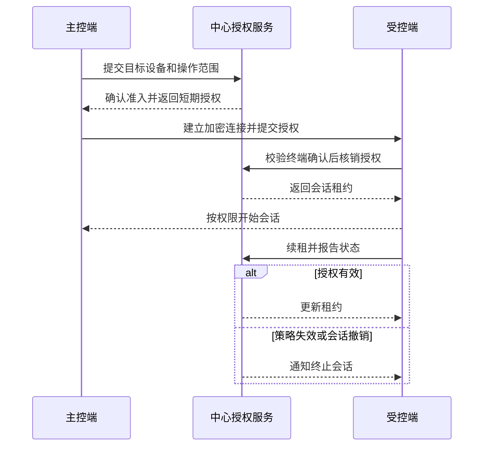

# 端域 DeskRealm 技术设计文档

**v0.1 评审稿 · 2026-11-22**

端域 DeskRealm 由端域控制台、中心服务、区域中继和端域远程客户端组成。需求范围、角色和完成标准见 [DeskRealm-PRD-v0.1.md](DeskRealm-PRD-v0.1.md)。本文给出首版的组件边界、接口、数据、部署和阶段验收。

## 1. 设计基线

| 决策 | 方案 |
| --- | --- |
| 实例 | 一个部署实例服务一个组织。中心持有账号、注册、授权、策略、任务和审计。Linux 以 Docker Compose 交付。 |
| 管理与终端 | Go 控制面与 PostgreSQL，Vue 和 TypeScript 实现中文控制台。客户端和会合、中继底座复用 RustDesk OSS，首版受管终端以 Windows 验收。 |
| 上游与对标版本 | RustDesk 桌面客户端 1.5.3、Server OSS 1.1.16 是初始传输与兼容验证基线。RustDesk Server Pro 1.8.8 用于核对公开功能和组织内有权验证的场景。 [客户端][client-release] · [OSS][oss-release] · [Pro][pro-release] |
| 客户端构建 | 以 RDGen 为参考，核对 `bryangerlach/rdgen` 与 `wztx/rustdesk-client` 的模板、构建任务和发布流程。端域使用自有构建环境、签名和设备登记。 [RDGen][rdgen] · [参考分支][rdgen-fork] |
| 会话强制管控 | 中心签发与撤销会话授权，受控端执行操作范围与租约。直连和中继的连接资格与会话权限一致。 |
| 区域中继 | 中心 `hbbs` 与 Go 控制面维护多个区域 `hbbr` 的候选池。首版由两端实测、主控端按双端 RTT 之和自动选中继，中心校验并绑定。支持站点约束、GeoIP 回退、探测入池、排空和重连选点。 |
| 自动化 | 首版覆盖中心安装、节点接入、构建与签名、分组发布、设备登记、策略回执和升级。任务查询、重试和恢复由平台提供。 |

## 2. 组件与通信

| 组件 | 部署位置 | 职责 |
| --- | --- | --- |
| 端域控制台 | 中心 HTTPS | 用户、设备、通讯录、ACL、策略、会话、审计、发布、节点与任务页面。各操作调用对应授权的 Go 接口。 |
| Go 控制面 | 中心 | 账号及设备身份、API、会话授权与租约、版本化策略、中继目录、部署任务、构建发起、发布与审计。首版在同一服务内按业务模块划分。 |
| PostgreSQL | 中心服务网 | 持久化用户、设备、策略、授权、发布、任务、审计和待投递事件。业务写入与待投递事件在同一事务提交。 |
| 会合服务 `hbbs` | 中心 | 设备在线、会合及向双方下发已确认的中继地址。M0 使用 OSS 原版。M2 起扩展受管身份与准入，M3 联动控制面的候选、双端实测和选点确认。 |
| 中继服务 `hbbr` | 中心可选，区域独立运行 | 配对并转发会话数据。M3 公网受管节点在配对前校验双方的中继票据。 |
| 节点管理进程 | 与区域 `hbbr` 同机 | 注册、上报健康和容量，应用版本化配置、执行授权范围内的更新任务。 |
| 端域远程客户端 | 受管 Windows 终端 | 初次登记、连接、授权核销、受控端操作限制、续租、撤销和回执。编码、传输和平台集成沿用审阅过的开源底座。 |
| 安装器、构建与签名执行环境 | 安装器在授权主机运行，构建和签名在受控环境 | 初始化中心或区域节点。按固定源码和模板构建产物，验证签名后发布。 |

客户端与中心交换身份、点到点会合、策略和审计元数据。远控画面、输入和已授权的文件流经端到端直连或区域 `hbbr`。控制台操作使用管理接口，节点管理和服务间协作使用经过认证的接口。 [RustDesk 自托管架构][selfhost]

| 关系 | 传输与用途 |
| --- | --- |
| 控制台和客户端到 Go | HTTPS。管理操作、身份、入网、会话和策略。 |
| 桌面终端到 `hbbs` | 原生 TCP/UDP 会合。服务端在受管模式中复核身份及授权。 |
| 终端之间，或终端经 `hbbr` | 加密远控数据。由受控端验证会话与执行权限，区域节点进行中继准入与容量管理。 |
| 节点管理进程与中心 | 节点身份认证的 HTTPS。登记、配置、容量、健康与任务回执。 |
| 控制面与数据库及内部服务 | 私网连接，服务间接口采用双向 TLS 或部署内等效的身份认证。 |

## 3. 用户、分组和设备身份

### 用户和后台权限

- 本地账号在首个管理员初始化以后支持邀请、创建、重置、启用、停用及归档。密码采用 Argon2id 和独立随机盐。TOTP 密钥单独加密，恢复流程进入审计。停用账号即时禁止登录和续租。 [RFC 9106][argon2]
- OIDC 桌面登录通过系统浏览器、授权码及 PKCE 完成。校验签发方、受众、回调、`state` 与 `nonce`。身份关联以 `issuer + subject` 为准，邮箱是展示属性。组织可用 IdP 接目录和 MFA。 [OIDC 功能][oidc] · [OAuth 安全建议][oauth]
- 管理授权由主体、资源、动作和作用域判定。平台管理员可委派本人或组范围的权限，审计员拥有批准的查询及导出权限。后台接口对实体 ID 操作和列表筛选分别校验。通用自动化 API Token 可限制作用域、有效期和权限，可单独撤销。
- 用户可属于多个用户组。终端有一个主设备组和标签，归属变更进入审计。归档或移交保留原用户与设备标识，供历史事件关联。组织保留至少一名可用的完整管理员。

### 受管设备登记

1. 控制台签发绑定目标组、用途和允许平台的短期单次凭据。组织部署工具将其与公共安装包分别发放。
2. 客户端在终端生成密钥，证明持有私钥后提交入网申请。服务端事务内消费凭据并登记设备。当任务明确允许自动批准时按规则入组，其余进入待审批。
3. 审批完成后颁发设备凭据，客户端开始可信心跳，并报告平台、版本和生效策略。登记状态与在线状态各自维护。
4. 设备内部 UUID 保持稳定。RustDesk ID 作为可变的连接地址，重名检查和变更都可审计。凭据轮换、新系统迁移或设备重装按原设备身份验证或经管理员批准。重复登记同一连接尝试返回已有结果。
5. 禁用或退役会撤销设备凭据并阻止授权与续租。过去的日志和本机数据归属保留其设备 UUID。

## 4. 会话授权、执行与撤销

### 权限判定

| 判定层 | 核心输入 | 执行点 |
| --- | --- | --- |
| 后台权限 | 登录、角色、动作、资源及作用域。 | Go 管理 API。 |
| 连接准入 | 主控用户、两端设备、设备组、账号状态、可信版本、申请用途与 ACL。 | 中心作出允许或拒绝。受管 `hbbs` 只协调授权连接，受控端核销授权。 |
| 会话操作 | 授权操作集合、控制角色、设备安全策略和适用的终端确认。 | 受控端实时执行允许范围的交集。 |

默认拒绝未获得授权的连接，显式拒绝优先。有人值守由终端显示请求范围并确认。无人值守仅对已经由资产管理流程授权的设备及用途生效。只读会话在受控端阻止键鼠、剪贴板和文件操作。官方 Control Role 的优先级与端域的交集规则分别作为兼容对标用例。 [官方会话角色][control-role]

1. **签发。** 中心以受认证的用户身份与设备身份核验请求。授权与会话记录绑定稳定用户 ID、主控设备、受控设备、操作范围、策略版本、有效期及唯一凭据 ID。签发、验证与密钥轮换使用受审阅的签名实现。
2. **核销。** 受控端确认加密连接的对端与授权绑定一致，验证签名、本次连接的设备持钥证明和适用的终端确认。在线请求核销时，中心在同一事务复核权限、版本和凭据状态。一份凭据只由第一个成功的连接核销，同一次请求可安全重试。凭据到期后重新申请。
3. **运行。** 受控端在通过核销后开放获准能力。首版拟用 60 秒的初始授权、30 秒的会话租约和 10 秒的续租间隔。受控端使用单调计时，系统从睡眠恢复时复核。统一校验所有启用的入站方式。缺少受管校验的直接 IP 入口在受管包中关闭。
4. **续租与撤销。** 权限收缩、停用、移除设备或手动断开后，中心原子更新授权状态并停止续租。全部后续核销与续租见到生效的新状态。在线终端接收通知并返回实际断开回执，失联终端按租约到期结束。管理台可见撤销请求、实际确认和租约等待。扩大权限通过一次新的授权。
5. **恢复。** 中心暂时不可达时，受管端拒绝新会话。既有会话按租约运行到到期。重新连接要取得新授权。原版客户端在独立试点入口验证兼容性，其连接记录与强管控验收分别标注。

在线撤销 5 秒内回执、隔离受控端后 35 秒内停止控制为初始验收目标。起点分别为中心提交撤销和受控端测试链路断开，结束点为实际停止控制及可关联的事件。测试需覆盖直连、中继和重启或睡眠后的租约。

## 5. 策略、通讯录和审计

| 模块 | 实现设计 |
| --- | --- |
| 策略选择 | 依设备、归属用户、主设备组顺序选择一个启用版本，否则使用组织默认。版本不可随意覆盖，记录分配、灰度范围、回滚来源和终端回执。 |
| 生效同步 | 控制面发布带版本的策略。终端按支持字段校验并回报已应用、失败字段和时间。管理台同时报告期望及实际版本。中心地址与身份材料使用受控安装和发布机制变更。 |
| 通讯录 | 条目关联稳定设备 UUID，显示设备 ID、别名、标签和备注。私有与共享通讯录独立授权为查看、编辑和管理。实际连接前仍需会话 ACL。 |
| 审计 | 业务事务记录后台变更及授权事件。设备按可信身份具名上报连接确认、开始结束、路径和文件操作必要元数据。节点上报配对及服务状态。 |
| 检索和留存 | 按授权的用户、组、设备、时间和会话 ID 检索及导出。记录真实时间与到达时间。事件以唯一 ID 去重，缺少回执时显示未确认或到期。集中录像作为独立留存能力在 M4 交付。 |

策略分配和权限的关联变更可触发重新授权或撤销。终端离线时保留最近有效策略，未知版本和未确认结果按其实际状态展示。通讯录中设备的权限由数据访问范围控制，日志导出继承审核范围。 [官方策略][strategy] · [官方通讯录][address] · [官方审计][audit]

## 6. 多区域中继、选点与故障

### 区域节点接入

- 管理员在控制台录入节点名称、站点、区域、公布地址、版本、可达网络及容量。平台生成绑定节点的部署任务和短期单次入网凭据。站点管理员在授权主机运行安装命令。
- 节点安装 `hbbr` 和节点管理进程，本机生成身份密钥，通过 HTTPS 校验中心身份并完成注册。区域节点持有自己的凭据和验证公钥。共享中心配置信息通过版本发布。
- 部署阶段可查待安装、安装中、已登记待探测、可用和失败。只有协议就绪、对目标网络的公布地址可达、容量状态有效的节点进入候选池。每个节点可进排空、故障、停用状态。更新地址先验证新端点。
- 受管公网模式对两条中继连接分别校验短期票据的节点、会话、来源角色和持有者。票据用于中继连接准入。端到端会话授权仍由受控端实施。 [官方区域中继参考][relay] · [OSS 中继入口][oss-relay]

### 客户端自动选点

1. **下发候选。** 需要走中继时，中心按明确的站点对规则、IP/CIDR 映射、允许区域、客户端可用的公布端点、健康及容量筛选节点。排空、失效或不符合约束的节点退出候选。使用本次已授权会话标识把候选与探测轮次交给双方。
2. **双端采样。** 主控端和受控端并发测量本轮候选，使用与会话相同的公布端点和传输方式执行有限的往返请求。探测权限限定在该会话及已下发节点。首版试点按每节点 3 次采样、至少 2 次成功取中位数及总窗口 2 秒设计，按实测调整。两端独立提交节点、轮次、往返时延（RTT）和失败原因。收到网络切换事件时重置本轮结果。
3. **选择并确认。** 主控客户端从本轮两端均具有效样本的候选中，按「主控端到节点的 RTT + 受控端到同一节点的 RTT」取最小值。同分按负载和稳定顺序决定。中心在绑定前复核候选权限、健康与容量，以会话为单位记录选点，并向两端下发同一节点地址和各自的中继票据。
4. **降级与重试。** 所有候选均缺少有效双端样本时，在可用且没有明确不可达证据的合规候选中，按站点优先、GeoIP 估算及默认区域顺序回退。建立失败时在总超时内排除失败节点，按实际测量或回退顺序尝试其余候选。候选耗尽时返回可诊断的中继失败。回退与重试的原因均可查询。
5. **健康和重连。** 中心独立探测节点的默认周期为 5 秒，连续三次失败时摘除，恢复需通过协议与可达性验证。会话一旦建立即绑定该中继，断线后重新授权、测量和选点。节点升级继续采用排空、升级、验活和入池流程。

例如两个获准候选中，节点 A 的双端样本为 20 ms 和 120 ms，节点 B 为 60 ms 和 50 ms。客户端选择双端合计 110 ms 的节点 B，中心仍在绑定时复核其可用性。

受管多中继扩展复用 OSS 选点入口作为集成位置。试点用同一中心、两端探测回执和实际中继节点日志核对结果。 [OSS 选点源码][oss-selection]

## 7. 安装、客户端构建与自动化

### 中心安装

1. 在支持的 Linux 主机执行中心安装入口，输入管理域名、ID Server 地址、TLS 模式、镜像源、数据目录和默认中继选项。首版测试 Ubuntu 24.04 LTS 与 Debian 12 的 amd64、arm64。
2. 预检端口、名称、DNS、磁盘、镜像及既有部署。已安装运行时可复用，受支持的空机部署匹配的容器运行环境。支持公网或组织镜像与具备签名清单的离线包。
3. 核对版本和镜像摘要后生成配置、创建持久卷、迁移数据库、启动服务并验证健康。通过主机管理入口创建单次初始化链接，创建首个本地管理员。输出 HTTPS 管理 URL、中心地址和公钥指纹及网络诊断。
4. 安装前后保持同一部署标识。在中心可用前本地记录步进状态，失败后重试清点实际已完成步骤。中心可用后将安装结果关联到控制台。 [自托管安装对标][pro-install]

### RDGen 参考构建与免填配置

| 步骤 | 设计结果 |
| --- | --- |
| 配置与模板 | 中心健康验证后生成版本化连接配置，包含 `ID Server`、HTTPS `API Server` 和服务器公钥 `Key`。构建模板取用该快照，附品牌、平台和允许的默认设置。`Relay Server` 采用中心下发候选、客户端实测并自动选择。 |
| 构建 | 管理员选择模板、已审阅的受管客户端源码版本、目标架构和发布组。隔离执行环境固定模板、依赖和工具链版本，记录构建日志、结果及摘要。 |
| 签名和发布 | 在受控签名环境完成签名，再自动校验签名与摘要。只有校验通过的产物可发布到发起时批准的目标组。失败保留现有发布，报告失败环节。 |
| 安装与登记 | Windows 签名包预置中心所需公开配置。下载及安装渠道按组织策略授权。每台设备的期限凭据单独授权和发放，首次启动后以本机设备密钥完成登记。 |
| 版本演进 | 站点和区域中继变化更新中心候选，新会话按更新后的候选自动选点。中心连接身份或公钥的更新走已授权的签名发布及迁移验证。已有官方客户端试点可用导入导出配置或 `--config`。 |

RDGen 的构建配置、版本化任务及产物发布方式用于设计自有流程。已有项目的镜像和脚本按实际引用的版本审核。客户端和受控签名服务的凭据使用不同访问范围。包内包含公开连接配置，设备入网和管理凭据从各自的授权路径发放。 [RDGen 自托管与签名][rdgen-setup] · [客户端配置][client-config]

### 任务执行与恢复

| 流程 | 触发与执行者 | 结果与恢复 |
| --- | --- | --- |
| 单机初始化 | 授权主机上的安装器。 | 在本地持久化步进记录，通过安装健康检查后并入中心任务状态。 |
| 区域中继接入 | 中心生成部署任务，节点管理进程提交证据。 | 按安装、登记、探测和入池记录结果。重试复用节点身份和有效配置。 |
| 客户端发布 | 角色在控制台发起带目标范围的任务。Go 派交隔离构建和签名步骤。 | 更新构建、校验、发布和终端结果。中断时检查已完成的产物和正式发布记录，再续跑。 |
| 设备纳管 | 组织部署任务或终端登记事件。 | 申请、审批、分组和策略回执可关联。失败原因可查，过期登记凭据按授权重签。 |
| 版本升级 | 管理员发起或配置已授权的发布计划。 | 节点排空、分批部署及验活。客户端灰度。失败暂停下一批，兼容时回滚，实际结果进入审计。 |

在 PostgreSQL 中记录任务、请求版本、目标批次、步骤、尝试和关键回执。平台用请求幂等键消除重提的任务，用目标级锁和状态版本防止并发写入。后台任务领取可恢复的执行租约，控制面重启后核对外部步骤证据，以幂等方式续做。失败按可安全重试的步骤重试，取消仅停止尚未执行或允许安全中止的步骤。

控制台显示排队、执行中、等待终端、成功、部分失败、失败和已取消。按任务和目标查日志。安装、发布、尝试、回滚和入网均关联同一任务或来源任务。任务日志中的凭据按类型隐藏，管理员仅查看其作用域内的结果。

## 8. 主要数据模型

| 实体 | 主要字段和约束 |
| --- | --- |
| 用户、身份、组成员 | 稳定用户 ID、账户状态、身份来源、登录与归属。联邦身份 `issuer + subject` 唯一。管理员移交与停用保留事件。 |
| 设备、设备组、登记凭据 | 设备 UUID、可变 RustDesk ID、主组、设备公钥、登记和连接状态、版本、最后心跳。入网凭据存摘要并原子消费。 |
| 管理角色、控制角色、访问规则 | 管理资源和作用域、会话操作集、来源和目标许可。每次生效变更有版本及历史。 |
| 策略、版本、分配、回执 | 原始版本、期望版本、实际版本、分配主体、灰度批次、应用失败和回滚来源。 |
| 通讯录、条目、共享 | 所有者、设备 UUID、别名、标签、共享主体及操作范围。设备退役保留历史引用。 |
| 远程会话、授权、租约和会话事件 | 会话 ID、双方、凭据 ID、核销状态、允许操作、来源策略、路径、中继节点、时间、状态与结束原因。授权和撤销按事务保护版本。 |
| 中继、探测、网段规则 | 节点身份、区域、站点、公布地址、容量、健康时间、配置版本、网段与目标关系。会话探测按轮次保存两端时延或失败摘要、候选版本、命中节点与回退原因。 |
| 模板、构建、签名与发布 | 已验证中心配置版本、源码与构建环境、产物摘要、签名状态、授权目标组、发布时间。已发布包保留可追溯来源。 |
| 自动化任务、步骤、回执 | 触发者或事件、操作范围、对象、状态、尝试、执行租约和结果。唯一请求键，归并重复回执。 |
| 审计与待投递事件 | ID、来源、操作者、关联会话或任务、发生与到达时间、范围和结果。在同一事务记录行为与待投递事件。 |

## 9. 接口安排

下表是首版接口边界，字段与错误响应在实现时版本化。管理接口对列表和寻址请求分别校验范围。更新接口在冲突时返回当前版本，重复的有效请求沿用对应的执行结果。

| 调用方 | 入口示例 | 用途 |
| --- | --- | --- |
| 端域控制台 | `/v1/admin/users`、`/v1/admin/user-groups`、`/v1/admin/user-invitations` | 账号、组与邀请。管理与操控角色分别分配。 |
| 端域控制台 | `/v1/admin/devices`、`/v1/admin/device-groups`、`/v1/admin/device-enrollments` | 设备查询、归属、登记审批及凭据生命周期。 |
| 端域控制台 | `/v1/admin/access-rules`、`/v1/admin/strategies` | 规则预览、策略版本和生效回执。 |
| 主控端 | `POST /v1/sessions` | 按目标及操作范围申请连接授权，绑定登录与设备身份。 |
| 主控端与受控端 | `GET /v1/sessions/{id}/relay-candidates`、`POST /v1/sessions/{id}/relay-probes` | 读取本次会话的候选和已提交测量结果，按探测轮次提交经设备身份校验的样本。 |
| 主控端 | `POST /v1/sessions/{id}/relay-selection` | 提交选定节点和探测轮次。中心校验当前授权及节点状态，并向两端下发绑定结果。 |
| 受控端 | `POST /v1/sessions/{id}/redeem`、`POST /v1/sessions/{id}/renew` | 核销和续租，验证本次连接、终端身份和有效版本。 |
| 管理员或审计员 | `POST /v1/admin/sessions/{id}/revoke`、`GET /v1/admin/audit-events` | 主动撤销或按权限查询、导出审计。 |
| 发布管理员 | `/v1/admin/relay-nodes`、`/v1/admin/relay-deployments`、`/v1/admin/client-builds` | 节点、部署凭据、构建和发布。登记状态与有效版本可查。 |
| 任务管理员 | `GET /v1/admin/tasks`、`GET /v1/admin/tasks/{id}`、`POST /v1/admin/tasks/{id}/retry`、`POST /v1/admin/tasks/{id}/cancel` | 查询逐对象结果，按范围重试或停止后续步骤。 |
| 会合与节点 | 内部认证接口 | 读取原子发布的节点和策略版本，上报健康、容量和回执。 |
| 原版客户端试点 | 客户端版本支持的 `/api/login`、`/api/currentUser`、`/api/ab`、`/api/heartbeat`、`/api/audit/{type}` 等 | 按固定版本做契约测试。试点入口的业务权限与受管授权单独验收。 [登录与账户源码][user-code] · [心跳][sync-code] · [审计路径][common-code] |

## 10. 部署、运行与迁移

| 连接 | 默认入口与边界 |
| --- | --- |
| 控制台与客户端 API | HTTPS TCP 443，管理入口按部署网络和角色收紧。 |
| 原生会合 `hbbs` | TCP 21115、21116 和 UDP 21116。 |
| 原生中继 `hbbr` | TCP 21117。各区公布给客户端可达的端点。 |
| WebSocket 扩展 | 按启用功能将 TCP 21118、21119 后端通过 WSS 入口反代。 |
| PostgreSQL 与内部协作 | 服务网，仅对有业务权限的组件开放。 |

端口与上游默认方式对齐。普通 HTTPS 反代负责 Web 和 WSS，原生 TCP/UDP 会合走对应网络入口。安装器报告局域网、域名、端口和云安全组待核对项。 [上游自托管端口与连接][selfhost]

- **备份和恢复。** 备份 PostgreSQL、服务端身份私钥、签名与设备凭据所需密钥及版本化配置。恢复先在隔离环境核对中心公钥、设备关联、策略、任务与审计。缓存的在线状态由正常登记和心跳重建。
- **升级。** 锁定发布版本和摘要，先核对数据库和终端兼容性，再灰度升级。验证失败时停止后续部署。兼容的版本用原镜像和配置回滚，数据库不兼容的恢复走预先验证的备份流程。
- **可观测性。** 指标和事件覆盖在线率、连接成功、直连比例、授权和撤销、策略回执、双端 RTT、命中与回退、重连重选、中继占用和任务积压。中继容量按并发实测及码率调整。
- **迁移。** 通过持有使用权限的导出和公开接口取得用户、设备及通讯录样本，核对字段、组范围和 RustDesk ID 映射。分批验证端域设备登记、策略和连接，保留回切方案。 [官方管理接口对标][console]
- **部署边界。** 首版采用单活中心和备份恢复，各区域独立启停。控制面故障时的活动会话按租约规则处理。并发、可用性和保留期根据试点容量数据确认。

## 11. 实施与验收安排

| 阶段 | 开发顺序 | 交付证据 |
| --- | --- | --- |
| M0 传输与安装基线 | 固定版本，验证空机安装原型、中心与一台中继。 | 两台 Windows 的注册、直连、强制中继和恢复。Parallels Windows 已具备，可先和宿主 Mac 验证一轮，正式记录 Windows 架构与版本。 |
| M1 用户、设备与管理面 | 账号、分组、角色、设备登记审批、通讯录、查询与任务台账。 | 本地登录及 OIDC、作用域、设备状态、任务重复提交和审计查询。 |
| M2 强制管控 | 两端受管客户端、ACL、会话权限、租约、撤销与策略回执。 | 两种路径同一准入和撤销语义。覆盖未授权、过期、并发核销、只读、禁用和断联。 |
| M3 一键部署与自动化交付 | 中心正式安装器、两个区域节点、双端实测自动选点、签名构建、免填入网、发布和升降级。 | 空机重跑、安装包签名、干净 Windows 免填连接、审批与策略。两区验证最低双端 RTT、候选边界、测量不足时回退、故障重连、灰度和失败恢复。 |
| M4 扩展对标 | 浏览器主控、原生 LDAP、邮件流程、更多平台和录像等高级功能。 | 每个平台和能力各自通过功能、权限与审计。 |

实际试点需确认 Linux 主机、域名和证书、可达的中继网络、Windows 架构与签名环境。当前 Parallels Windows 的安装完成可用作测试前置条件。正式连接与交付能力以真实环境结果为准。

### 需求追踪

| 需求编号 | 主要设计章节 | 验收 |
| --- | --- | --- |
| FR-01 | 7 中心安装、10 部署 | AT-01 |
| FR-02、FR-03、FR-04 | 3 身份与设备、8 数据模型、9 接口 | AT-02 |
| FR-05、FR-06 | 7 构建与免填配置、8 构建发布 | AT-03 |
| FR-07 | 5 通讯录、9 接口 | AT-04 |
| FR-08、FR-09 | 2 通信、4 会话准入与撤销 | AT-04、AT-05、AT-09 |
| FR-10、FR-11 | 4 受控端执行与租约 | AT-05 |
| FR-12、FR-13 | 5 策略与审计、8 版本与事件 | AT-06 |
| FR-14、FR-15 | 6 区域节点与选点 | AT-07 |
| FR-16 | 7 自动化、8 任务、9 任务中心 | AT-03、AT-07、AT-08 |
| FR-17 | 7 安装与升级任务、10 备份恢复 | AT-01、AT-08 |
| FR-18 | 2 端域控制台与客户端、3 权限与登记、9 管理接口 | AT-02 |
| FR-19 | 4 兼容试点、9 版本接口、10 迁移 | AT-09 |
| NFR-01、NFR-02、NFR-03 | 3 身份、4 会话、7 签名 | AT-03、AT-04、AT-05 |
| NFR-04、NFR-05、NFR-06 | 7 恢复、10 部署与运维 | AT-01、AT-06、AT-07、AT-08、AT-09 |

## 12. 开源合规与版本维护

端域以 RustDesk OSS 服务端和客户端为传输底座，它们的公开仓库采用 AGPL-3.0。对修改后提供网络交互的软件，按第 13 条向与该版本远程交互的用户显著提供免费获取对应源码的方式。分发客户端时依据相应发布义务交付。记录依赖、改动、构建方法及第三方许可证，评审独立控制面与派生组件的关系。 [RustDesk 客户端][client-repo] · [Server OSS][oss-repo] · [AGPL-3.0][agpl]

RDGen 与参考分支用于实现评估。采用其代码或构建产物前按所用版本核对许可证和分发要求，构建任务记录审阅过的提交。Pro 的公开能力和获授权的实际操作用于验证需求，端域界面、控制面及交付流程由团队独立设计。 [RDGen 参考分支许可证][rdgen-license] · [RustDesk 使用条款][terms]

本稿为技术设计评审版。接口、数据模型和验收路径可供实施，尚需以实测验证安装、传输兼容性、撤销时限、签名和回滚。

[client-release]: https://github.com/rustdesk/rustdesk/releases/tag/1.5.3
[oss-release]: https://github.com/rustdesk/rustdesk-server/releases/tag/1.1.16
[pro-release]: https://github.com/rustdesk/rustdesk-server-pro/releases/tag/1.8.8
[rdgen]: https://github.com/bryangerlach/rdgen
[rdgen-fork]: https://github.com/wztx/rustdesk-client
[rdgen-setup]: https://github.com/wztx/rustdesk-client/blob/master/setup.md
[rdgen-license]: https://github.com/wztx/rustdesk-client/blob/master/LICENSE
[selfhost]: https://rustdesk.com/docs/en/self-host/
[control-role]: https://rustdesk.com/docs/en/self-host/rustdesk-server-pro/control-role/
[strategy]: https://rustdesk.com/docs/en/self-host/rustdesk-server-pro/strategy/
[address]: https://rustdesk.com/docs/en/self-host/rustdesk-server-pro/address-book/
[audit]: https://rustdesk.com/docs/en/self-host/rustdesk-server-pro/audit-logs/
[relay]: https://rustdesk.com/docs/en/self-host/rustdesk-server-pro/relay/
[pro-install]: https://rustdesk.com/docs/en/self-host/rustdesk-server-pro/installscript/
[client-config]: https://rustdesk.com/docs/en/self-host/client-configuration/
[console]: https://rustdesk.com/docs/en/self-host/rustdesk-server-pro/console/
[oidc]: https://rustdesk.com/docs/en/self-host/rustdesk-server-pro/oidc/
[oauth]: https://www.rfc-editor.org/rfc/rfc9700.html
[argon2]: https://www.rfc-editor.org/rfc/rfc9106.html
[terms]: https://rustdesk.com/terms/
[oss-selection]: https://github.com/rustdesk/rustdesk-server/blob/1.1.16/src/rendezvous_server.rs#L913-L927
[oss-relay]: https://github.com/rustdesk/rustdesk-server/blob/1.1.16/src/relay_server.rs#L425-L460
[user-code]: https://github.com/rustdesk/rustdesk/blob/1.5.3/flutter/lib/models/user_model.dart
[sync-code]: https://github.com/rustdesk/rustdesk/blob/1.5.3/src/hbbs_http/sync.rs
[common-code]: https://github.com/rustdesk/rustdesk/blob/1.5.3/src/common.rs#L1373-L1379
[client-repo]: https://github.com/rustdesk/rustdesk
[oss-repo]: https://github.com/rustdesk/rustdesk-server
[agpl]: https://opensource.org/license/agpl-3.0
