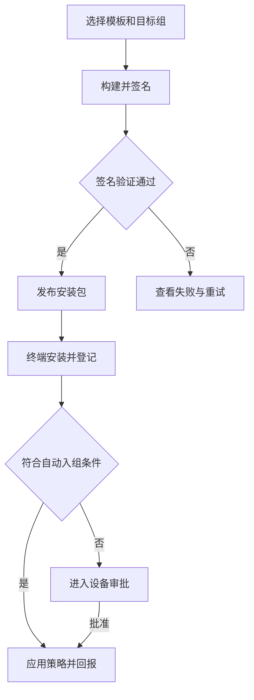

# 端域 DeskRealm UI 设计文档

**v0.1 评审稿 · 2026-11-22**

适用于端域控制台和端域远程客户端。首版以 Web 管理和 Windows 受管终端为交付范围。配套资料见 [产品需求](https://chatgpt.com/library?file_id=libfile_8d8ce4dcec9481919d87d0deec799d6e&account_id=personal)、[系统设计](https://chatgpt.com/library?file_id=libfile_f396fa44d5f881918b1b5f0c026cdd8b&account_id=personal)、[技术栈及路线图](https://chatgpt.com/library?file_id=libfile_e65fe94ba96c8191ae887ab3e707aba1&account_id=personal)及 [高保真原型图](DeskRealm-UI-Prototype-v0.1.pdf)。

## 1. 界面目标

管理员从控制台完成用户和设备管理、区域接入、客户端发布及任务复核。运维人员从获准的设备或通讯录入口发起连接。终端使用者能看到所属中心、登记结果、发起人及适用的操作权限。界面保持简洁，优先展示当前状态、可执行操作和失败后的恢复入口。

首版以「创建中心、加入中继、构建签名包、免填入网、会话授权和撤销」作为串联路径。在安装、审批、发布和断开等异步步骤显示实际回执。浏览器主控和录像视图按 M4 范围设计。

## 2. 信息架构与角色

控制台桌面布局采用左侧导航、顶部组织及身份区域、内容区和按需打开的详情抽屉。列表到详情保持过滤条件。页面的主操作置于标题右侧，批量操作区在选中记录后出现。Windows 客户端以设备状态、发起连接和授权确认作为首版入口。

| 一级入口 | 页面及子入口 | 典型可见角色 | 关联需求 |
| --- | --- | --- | --- |
| 概览 | 设备、会话、中继、待办和任务摘要 | 管理员、组管理员、运维人员 | FR-04、FR-13、FR-18 |
| 用户与权限 | 用户、用户组、管理角色、控制角色、API Token | 平台管理员、受委派组管理员 | FR-02、FR-03 |
| 设备管理 | 设备列表、设备组、登记审批和详情 | 管理员、组管理员、运维人员 | FR-04、FR-06 |
| 通讯录 | 我的通讯录、共享通讯录和编辑共享范围 | 获准的登录用户 | FR-07 |
| 访问策略 | 连接 ACL、权限预览、终端策略版本和生效回执 | 管理员或获委派人员 | FR-09、FR-10、FR-12 |
| 会话与审计 | 活动会话、会话详情、操作事件、导出 | 管理员、运维人员、审计员按分配权限访问 | FR-08、FR-11、FR-13 |
| 区域中继 | 节点列表、部署、探测、地址调整与排空 | 平台管理员或获委派人员 | FR-14、FR-15 |
| 客户端发布 | 品牌模板、构建、签名、发布和回收 | 发布管理员、各组获准的下载用户 | FR-05、FR-06 |
| 任务中心 | 部署、构建、登记、升级、备份与回滚 | 创建任务的用户及对应范围内的管理员 | FR-16、FR-17 |
| 系统设置 | 中心信息、身份源、HTTPS、备份与授权导入 | 平台管理员 | FR-01、FR-17、FR-19 |

后台菜单依据管理角色及作用域生成。设备详情与会话按钮依据连接 ACL 和设备状态显示。受控端根据会话范围展示可用能力和请求确认。审计员在授权范围内查询与导出，设备修改与会话控制由各自的操作权限判定。

## 3. 视觉与组件规范

| 项目 | 规格 |
| --- | --- |
| 品牌与文本 | 主品牌「端域」，辅助标识「DeskRealm」。Web 使用 Noto Sans CJK SC、苹方或微软雅黑回退。Windows 客户端使用系统字体。 |
| 配色 | 主色 `#5148DD`，背景 `#F5F7FB`，卡片 `#FFFFFF`，正文 `#192033`，辅助文字 `#617087`，描边 `#E5EAF3`。 |
| 状态色 | 绿色表示可用或已完成，琥珀色表示待确认或部分失败，红色表示故障或拒绝，灰色表示停用或未知。颜色与文字状态共同显示。 |
| 布局 | 桌面基准 1440 × 900。左侧栏约 208 px，顶部栏 64 px，内容边距 28–32 px。使用 4 px 的间距单位，卡片圆角 12 px。 |
| 字级 | 页面标题 29–32 px，卡片标题 15–17 px，正文 13–14 px，时间与辅助信息 12 px。设备 ID、版本、摘要和端口使用等宽数字。 |
| 表格 | 搜索及作用域过滤位于表格上方。首列为名称或身份，状态与动作在相关字段附近。列表支持行详情、分页、失败原因和结果回执。 |
| 按钮 | 主按钮用于当前任务的主要操作。取消、下载、查看日志使用次级按钮。停用、撤销和排空按影响范围展示确认。 |
| 抽屉与弹窗 | 抽屉查看设备、会话和任务的上下文。短弹窗处理授权确认、撤销请求和发布确认。Esc 关闭可取消的弹窗并将焦点还给触发按钮。 |
| 窄屏 | 侧栏转为导航抽屉。详情以独立页显示。标题操作折叠为菜单，关键身份、状态、错误及操作仍可阅读。 |

按键焦点应可见。文字对比度按 4.5:1 为目标，主要按钮可用键盘触发。状态需要用文字及图标表达。对话框以明确的主体、对象、影响和动作命名。

## 4. 页面规格

| 页面或状态 | 布局与主要字段 | 操作与反馈 |
| --- | --- | --- |
| 一键部署 | Linux 中心安装器展示管理域名、ID Server、TLS、镜像源、数据目录及步骤结果。中继表单展示节点名称、区域、站点、公布端点、可达范围和并发容量。 | 中心安装预检后启动并验活，跳转一次性首登入口。中继生成绑定节点的限时部署命令，依次展示安装、登记、探测和入池。失败后按记录续跑。 |
| 首次初始化与登录 | 中心健康检查、一次性初始化状态、管理员账号设置。常规登录展示本地登录及已配置的 OIDC。 | 设置首个账号后进入控制台。过期链接显示重新生成方式。登录失败回到当前步骤并聚焦可纠正字段。 |
| 概览 | 四张摘要展示在线设备、待审批、活动会话、可用中继。下方放近期会话、待办及发布状态。 | 点击待办带筛选跳转到目标页。刷新和无权访问的指标显示各自状态。 |
| 用户与权限 | 用户、用户组、角色页签，列表显示账号、来源、管理角色、组、状态和最近登录。 | 新建、邀请、移动组、停用和归档视授权提供。停用确认展示受影响会话和待回执状态。 |
| 设备管理 | 搜索、组及审批筛选。表格各自显示登记与连接状态。详情包含 RustDesk ID、端域设备 UUID、平台、组、版本和期望／已生效策略。 | 选行打开详情，支持审批、分组、策略、轮换和退役。只有批准且有连接权限的设备显示可用连接动作。 |
| 通讯录 | 个人或共享册、设备名称、标签、备注及共享范围。 | 可按权限新增、整理和共享。点击连接重新请求会话 ACL。 |
| 访问策略 | ACL 来源和目标、允许范围、拒绝规则，终端策略展示归属、版本、分配目标与回执。 | 变更前预览匹配规则和受影响设备。发布后查看版本，失败可部分重试或选择兼容版本回滚。 |
| 会话与审计 | 会话 ID、发起端、受控端、开始时间、路径和状态。详情显示权限、连接证据及审计时间线。 | 有权管理员可以请求断开。保存请求时显示等待回执，受控端实际停止后显示已确认。失联等待租约到期。 |
| 区域中继 | 可用、待探测、排空和故障节点，按区域筛选。详情提供公布端点、容量、探测与模型版本。 | 添加节点生成部署命令。通过探测后显示入池。发起排空时展示当前会话，地址切换经探测后更新。 |
| 客户端发布 | 选品牌、源版本、Windows 架构及目标组。连接配置取自中心，展示 ID Server、API 地址、公钥指纹、配置来源与版本。 | 预览后构建，签名与验证通过后发布。构建失败入口跳到任务和日志。设备登记状态由部署任务反馈。 |
| 任务中心 | 类型、结果、来源、目标、版本和时间。右侧详情展示步骤、重试次数、结果与受影响对象。 | 重试时总结失败项与作用域。可取消尚未运行的步骤。发布、回滚和恢复保存实际结果。 |
| 系统设置 | 中心域名、证书模式、服务探测、公钥指纹、镜像来源、备份和现有配置导入。 | 按权限查看和修改，公布地址测试失败时显示哪一项待处理。历史备份与恢复操作可追溯。 |
| Windows 客户端 | 主页显示所属组织、本机设备 ID、登记状态、策略和可连接的设备入口。会话申请显示发起方、来源设备和操作范围。 | 初始配置随安装包生效。待审批时展示下一步。有人值守请求可在受控端允许或拒绝。会话中保留状态和退出入口。 |

## 5. 关键交互

### 5.1 从发布到设备入网

控制台默认引用中心验证后的配置版本。发布预览显示目标组、平台架构、构建版本及签名状态。入网凭据由组织按设备发放，安装包展示公开配置。自动连接后区分「已登记待审批」与「已批准且策略生效」。

Windows x64 和 ARM64 的构建、签名及回执分别记录。原型以 x64 发布为例。使用本机 Parallels Windows 虚拟机验收时，按客户机架构选择对应的安装包。

### 5.2 多中继选点的界面表达

在「区域中继」列表查看节点是否可用，在会话详情查看该次连接参与的候选、主控 RTT、受控 RTT、合计和选择原因。候选例值沿用系统设计。只有两端均有有效样本的节点参与本轮合计排序。

| 候选节点 | 主控 RTT | 受控 RTT | 合计 | 本次结果 |
| --- | --- | --- | --- | --- |
| 东京 | 20 ms | 120 ms | 140 ms | 合规候选 |
| 新加坡 | 60 ms | 50 ms | 110 ms | 已选中 |

没有有效的双端样本时显示「站点规则回退」或「GeoIP 回退」。节点故障触发重连时先显示重新测量和选点，取得新路径后再更新中继名称。历史会话保留旧路径及结束事件。

### 5.3 连接确认、会话权限与撤销

主控端选择设备并发起请求。受控端弹窗显示已认证的发起人和实际申请的权限，根据终端策略展示允许与拒绝。只读会话在工具栏标注只读，输入、剪贴板和文件操作按钮按作用域禁用或隐藏，并在操作提示中说明原因。点击「断开会话」时先确认目标会话，提交后显示「等待终端回执」。设备失联时显示「等待租约到期」，在获得结束事件或达到租约终止条件后更新最终状态。

## 6. 状态、内容与无障碍

| 体验 | 处理 |
| --- | --- |
| 加载与空态 | 列表加载使用同宽骨架。空态只显示必要说明和一个相关动作。过滤无结果时提供清空筛选入口。 |
| 失败与重试 | 显示失败环节、可执行修复和重试范围。任务部分失败保留成功记录。无可用中继时说明无法建立该路径。 |
| 进行中与回执 | 网络在线、设备批准、策略生效各用独立字段。避免把任务提交、签名待验证或会话撤销请求显示为最终成功。 |
| 无权操作 | 跨范围数据由服务端过滤。可以查看但不能操作时，界面说明需哪一项权限。后台无权入口按角色隐藏。 |
| 敏感内容 | 私钥、签名凭据和入网令牌以权限及一次性发放规则处理。通用列表显示公钥指纹和令牌有效期等必要信息。 |
| 键盘与屏幕阅读 | 控件有可读名称、表单错误与字段关联。Tab 顺序跟随呈现，状态与结果可由辅助技术读出。 |

## 7. 原型覆盖与验收对应

| 页码 | 高保真页面 | 重点验收 |
| --- | --- | --- |
| 1 | 控制台概览 | AT-02、AT-06，验证角色入口和状态联动。 |
| 2 | 用户与权限 | AT-02，验证状态、作用域和常用管理操作。 |
| 3 | 设备管理 | AT-02、AT-03，验证登记审批、设备详情与策略回执。 |
| 4 | 区域中继与会话选点 | AT-07，验证节点健康、候选双端 RTT 与选中依据。 |
| 5 | 客户端发布 | AT-03、AT-08，验证中心预置、架构、签名和发布范围。 |
| 6 | 任务中心 | AT-08，验证部分失败、步骤记录与重试。 |
| 7 | 会话与审计 | AT-04、AT-05、AT-06，验证连接路径、权限和断开回执。 |
| 8 | 首次管理员初始化 | AT-01，验证安装状态、一次性初始化和带安全校验的首登。 |
| 9 | Windows 客户端与连接确认 | AT-03、AT-04、AT-05，验证免填入网、只读请求和受控端同意。 |
| 10 | 一键部署 | AT-01、AT-07，验证安装器步骤反馈、区域中继接入表单和入池进度。 |

原型使用示例账号、节点及任务数据。PDF 支持书签和部分导航跳转。实际部署的端点、回执和联网测试在 M0 至 M3 按计划记录。
